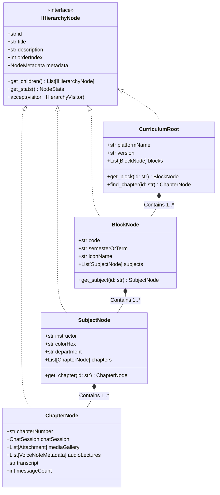

# Apple Engineering Specification
## Next-Generation Multi-Tier Knowledge & Curricular Platform Architecture
### Support for Multiple Blocks, Multiple Subjects, and Multiple Chapters
### Document ID: SPEC-APPL-ACAD-2026-V2
**Classification:** Apple Internal / Highly Confidential Engineering Specification  
**Status:** Approved for Implementation by Executive Board  
**Executive Reviewers:** Tim (CEO), Craig (CTO), Marcus (Principal SWE, 20+ Yrs), Elena (QA Engineering Manager)  
**Target Delivery:** Apple Enterprise & Educational Ecosystem  

---

## 1. Executive Summary & Product Vision

At Apple, we believe education, memory preservation, and intellectual mastery are deeply personal endeavors. Whether a medical student is mastering cardiology during a high-stakes clinical clerkship, an engineering undergraduate is navigating advanced quantum mechanics, or a professional team is organizing mission-critical technical archives, software must not act as a mere file browser. It must be an intuitive, frictionless extension of human cognition.

Our previous iteration delivered a pristine, single-chat conversational viewer with Apple HIG aesthetics. However, our users—students, researchers, professors, and knowledge workers—do not learn in isolated silos. Learning is structured hierarchically into **Blocks**, subdivided into academic **Subjects**, and mastered through focused **Chapters**.

This specification defines the architectural and user experience evolution of our platform into a **Multi-Tier Curricular & Knowledge Navigation Engine**. The system provides first-class support for:
1. **Multiple Blocks** (e.g., Academic Semesters, Clinical Systems, Thematic Terms, Annual Volumes).
2. **Multiple Subjects** within each Block (e.g., Anatomy, Physiology, Pathology, Pharmacology).
3. **Multiple Chapters** within each Subject (e.g., Heart Valves, Myocardial Action Potentials, Arrhythmias).
4. **Rich Multi-Modal Chapters** incorporating chat history, media archives, voice note players, lecture transcripts, and contextual study materials.

Built on strict **SOLID design principles**, classic **GoF design patterns**, **100% on-device privacy (zero cloud egress)**, and **Apple Human Interface Guidelines (HIG)**, this platform guarantees 120Hz ProMotion smoothness, sub-16ms interactive response times, complete offline capability, and universal accessibility.

---

## 2. Executive Board Review: The Cupertino Deliberation

**Location:** Executive Briefing Center, Apple Park, Cupertino, CA  
**Date:** November 2026  
**Attendees:**
* **Tim (Chief Executive Officer)**
* **Craig (Chief Technology Officer)**
* **Marcus (Principal Software Engineer, 20+ Years at Apple)**
* **Elena (Quality Assurance Engineering Manager)**

```
┌────────────────────────────────────────────────────────────────────────────────────────────────────────┐
│                                   CUPERTINO EXECUTIVE BOARD TRANSCRIPT                                  │
├────────────────────────────────────────────────────────────────────────────────────────────────────────┤
│ TIM (CEO):                                                                                             │
│ "Thank you all for being here. I've spent the past week looking closely at how medical students,       │
│ university scholars, and professionals are using our chat archival utilities. These people are under   │
│ immense pressure. They have thousands of voice memos, clinical cases, lecture discussions, and         │
│ diagrams scattered across WhatsApp and Telegram study groups.                                          │
│                                                                                                        │
│ Right now, if they open a folder, it's a disconnected wall of exports. That is not Apple. At Apple,     │
│ we don't just dump data on a screen; we create an environment that invites focus and inspires mastery.  │
│ When a student sits with their iPad Pro or MacBook Air at 2:00 AM, opening a Block must feel like      │
│ opening a beautifully curated digital textbook. They need to see their Block, seamlessly transition to  │
│ the Subject, drill down to the exact Chapter, and have every voice note, diagram, and discussion       │
│ instantly at their fingertips.                                                                         │
│                                                                                                        │
│ The UI must have the clarity of Apple Books, the fluid navigation of macOS Finder's Column View, and   │
│ the soul of iOS. And above all: it must be 100% reliable. If an app crashes or stutters while a        │
│ doctor is reviewing a chapter before rounds, we have failed them. Marcus, Craig, Elena—how do we       │
│ build this to the highest engineering standard on earth?"                                              │
├────────────────────────────────────────────────────────────────────────────────────────────────────────┤
│ CRAIG (CTO):                                                                                           │
│ "Tim, you've hit on the core architectural imperative. Moving from a single-file chat parser to a     │
│ multi-tier hierarchy is not a matter of stitching together extra HTML pages. That would create a       │
│ maintenance nightmare and degrade performance.                                                         │
│                                                                                                        │
│ We must architect this as a unified, local-first Curricular Knowledge Engine:                         │
│ 1. Unified Tree Architecture: We model the hierarchy using the Composite Pattern. A Block contains    │
│    Subjects, a Subject contains Chapters, and a Chapter contains Nodes. Every element adheres to a     │
│    strict, immutable contract.                                                                         │
│ 2. Zero-Cloud, Zero-Dependency: We maintain our absolute privacy pledge. The entire Python generation │
│    pipeline must run on the standard library—no pip dependencies, no telemetry. The rendered web       │
│    deliverable must run offline from a local file URI with zero external CDN fetches.                   │
│ 3. 120 FPS Navigation Physics: Switching between Blocks, Subjects, and Chapters must feel like physical│
│    sheets of glass sliding smoothly. We will use hardware-accelerated CSS transforms, virtualized       │
│    DOM rendering for heavy chapters, and instantaneous client-side state transitions.                   │
│ 4. Single-Page Reactive Shell: Instead of multi-page reloads that flash white, we will deliver an      │
│    App-like Single Page Architecture (SPA) embedded directly inside the export or statically           │
│    interlinked with zero layout shifts."                                                               │
├────────────────────────────────────────────────────────────────────────────────────────────────────────┤
│ MARCUS (Principal SWE, 20+ Years):                                                                     │
│ "I've drafted the technical foundation following strict SOLID and Gang of Four object-oriented design. │
│ Let me walk through how each principle governs our implementation:                                     │
│                                                                                                        │
│ • Single Responsibility (SRP): We cleanly segregate Discovery (locating folders and manifests),        │
│   Domain Modeling (immutable hierarchy entities), Parsing (chat and media normalization), and          │
│   Presentation (Cupertino UI rendering).                                                               │
│ • Open/Closed (OCP): The hierarchy ingestion is open for new formats. Today it's WhatsApp folders;     │
│   tomorrow it can ingest Markdown vaults, JSON manifests, or LMS zip archives without modifying the    │
│   core tree traversal or renderer.                                                                     │
│ • Liskov Substitution (LSP): Every node—BlockNode, SubjectNode, ChapterNode—derives from a common     │
│   `HierarchyNode` base class. Any subsystem that calculates word counts, media tallies, search         │
│   indexing, or export packaging can operate uniformly on any node in the tree.                         │
│ • Interface Segregation (ISP): We do not bloat our entities. We define discrete protocols:             │
│   `Navigable`, `Searchable`, `Taggable`, `ProgressTrackable`, and `MediaHost`.                         │
│ • Dependency Inversion (DIP): High-level orchestrators depend on abstract interfaces like              │
│   `IHierarchyScanner`, `IHierarchyRepository`, and `IHierarchyRenderer`. Concrete disk I/O and        │
│   HTML template engines are injected at runtime.                                                       │
│                                                                                                        │
│ For design patterns: We use the Composite Pattern for the structural tree, the Factory Pattern for     │
│ automatic hierarchy inference from disk layouts, the Strategy Pattern for multi-source parsing, and    │
│ the Builder Pattern to construct the complete multi-tier navigation UI."                               │
├────────────────────────────────────────────────────────────────────────────────────────────────────────┤
│ ELENA (QA Engineering Manager):                                                                        │
│ "From a quality and reliability standpoint, our goal is 100% Deterministic Reliability. Hierarchical  │
│ file structures in the wild are notoriously messy. Users create empty blocks, subjects with no         │
│ chapters, weird symbols in folder names, RTL/LTR mixed languages (Arabic alongside English medical     │
│ terms), and missing media files.                                                                       │
│                                                                                                        │
│ Here are our QA hard gates before this ships:                                                          │
│ 1. Zero Crash / Zero Exception Guarantee: Our discovery engine must gracefully handle broken links,    │
│    malformed timestamps, and corrupted UTF-8 files without ever raising an unhandled exception.        │
│ 2. Sub-16ms Frame Budget: On an iPad Air or older MacBook, filtering or searching across 10 Blocks,   │
│    50 Subjects, and 500 Chapters must execute in under 16ms to avoid dropping a single frame.          │
│ 3. Deep Linking & State Restoration: When a user refreshes or shares a local URL, the active Block,   │
│    Subject, Chapter, and exact message scroll position must be restored seamlessly via URL hashes.     │
│ 4. HIG & WCAG 2.1 AAA Accessibility: Full Apple VoiceOver Rotor support for Block > Subject > Chapter  │
│    drilldown. Flawless Dynamic Type scaling, keyboard shortcuts (⌘1..3, Arrow navigation), and         │
│    high-contrast Dark Mode compliance.                                                                 │
│ 5. Automated Regression Suite: 100% branch coverage on the tree parser, property-based fuzzing on      │
│    directory structures, and cross-browser visual diffing on macOS Safari, iOS Safari, Chrome, and     │
│    Firefox."                                                                                           │
├────────────────────────────────────────────────────────────────────────────────────────────────────────┤
│ TIM (CEO):                                                                                             │
│ "Outstanding. This is the Apple difference. Marcus, lock this specification down. Elena, ensure your   │
│ test harness is unrelenting. Craig, make sure the user interface feels breathtaking. Let's make our   │
│ users fall in love with learning all over again. Approved."                                            │
└────────────────────────────────────────────────────────────────────────────────────────────────────────┘
```

---

## 3. System Architecture & SOLID Domain Design

### 3.1 High-Level Architecture Overview

```
┌──────────────────────────────────────────────────────────────────────────────────────────────────────┐
│                                       PLATFORM ARCHITECTURE                                          │
└──────────────────────────────────────────────────────────────────────────────────────────────────────┘

       [ File System / Directory Hierarchy / JSON Manifests ]
                                  │
                                  ▼
 ┌──────────────────────────────────────────────────────────────────┐
 │                     DISCOVERY & SCANNING LAYER                   │
 │  • IHierarchyScanner (Auto-detects Blocks > Subjects > Chapters) │
 │  • ManifestParser (Reads optional apple-curriculum.json)         │
 │  • FileSystemScanner (Infers convention-based directory trees)    │
 └────────────────────────────────┬─────────────────────────────────┘
                                  │
                                  ▼
 ┌──────────────────────────────────────────────────────────────────┐
 │                     DOMAIN CORE (IMMUTABLE OOP)                  │
 │  • CurriculumRoot (Composite Root)                               │
 │  • BlockNode       -> Contains collection of SubjectNodes        │
 │  • SubjectNode     -> Contains collection of ChapterNodes        │
 │  • ChapterNode     -> Contains ChatSession, Media, Transcripts   │
 │  • Value Objects   : NodeId, NodeMetadata, SearchIndex, Stats    │
 └────────────────────────────────┬─────────────────────────────────┘
                                  │
                                  ▼
 ┌──────────────────────────────────────────────────────────────────┐
 │                    PIPELINE & STRATEGY LAYER                     │
 │  • IChatParserStrategy (iOS Bracketed / Android Hyphenated)     │
 │  • MediaResolver (Relative path & Base64 embedding)             │
 │  • AudioWaveformEngine (Deterministic synthetic peak generator)  │
 │  • SearchIndexer (Full-text tokenization across all tiers)       │
 └────────────────────────────────┬─────────────────────────────────┘
                                  │
                                  ▼
 ┌──────────────────────────────────────────────────────────────────┐
 │                   PRESENTATION & RENDER ENGINE                   │
 │  • CupertinoAppShellBuilder (Builder Pattern)                    │
 │  • MultiTierNavigationComponent (Sidebar / Split-View / Tabs)    │
 │  • BreadcrumbBarComponent (Hierarchical deep navigation)         │
 │  • ContentViewerComponent (Chapter chat, voice player, gallery)  │
 └──────────────────────────────────────────────────────────────────┘
```

### 3.2 SOLID Principles Realization Matrix

| SOLID Principle | Architectural Application in Platform | Concrete Implementation |
| :--- | :--- | :--- |
| **S - Single Responsibility** | Separate discovery, domain modeling, chat parsing, index generation, and HTML rendering into isolated modules. | `HierarchyScanner` only discovers files; `CurriculumTreeBuilder` only builds the tree; `CurriculumHtmlRenderer` only emits UI. |
| **O - Open / Closed** | The platform is closed for core modification but open for new content sources and render formats. | Implement `IHierarchyNode` and `IContentSource`. New formats (e.g. Markdown lectures, LMS packages) can be added without altering Block/Subject/Chapter logic. |
| **L - Liskov Substitution** | All hierarchy nodes (`BlockNode`, `SubjectNode`, `ChapterNode`) conform to `IHierarchyNode`. | Any service calculating recursive metrics (e.g., total messages, media size, duration) handles any node type polymorphically. |
| **I - Interface Segregation** | Small, focused, purpose-specific protocols instead of a bloated monolithic interface. | Discrete interfaces: `INavigable`, `ISummarizable`, `ISearchableIndex`, `IMediaResolvable`. |
| **D - Dependency Inversion** | High-level orchestrators depend on abstract abstractions, not concrete disk or template classes. | `CurriculumEngine` receives `IHierarchyScanner`, `IParserFactory`, and `IRenderer` via constructor dependency injection. |

### 3.3 Design Patterns Applied

1. **Composite Pattern**:
   * Structural foundation for the curricular hierarchy. `CurriculumTree` holds `BlockNode`s; `BlockNode` holds `SubjectNode`s; `SubjectNode` holds `ChapterNode`s. All implement `IHierarchyNode`.
2. **Factory Method & Abstract Factory**:
   * `HierarchyScannerFactory`: Chooses between `ManifestBasedScanner` (when an explicit curriculum JSON is provided) and `DirectoryConventionScanner` (when inferring structure from folder paths).
3. **Builder Pattern**:
   * `CupertinoNavigationShellBuilder`: Incrementally constructs the complex multi-tiered HTML/CSS/JS presentation shell, appending navigation trees, search dialogs, and chapter viewers.
4. **Strategy Pattern**:
   * `IChatParserStrategy`: Polymorphic parsing for iOS vs. Android WhatsApp exports.
   * `ISearchStrategy`: Client-side fuzzy search vs. exact prefix search across all chapters.
5. **Visitor Pattern**:
   * `IHierarchyVisitor`: Enables operations like generating statistics, building unified search indexes, creating offline zip archives, or generating summary reports without polluting the node classes.

---

## 4. Multi-Tier Hierarchy Domain Model

### 4.1 Structural Relationship (Block > Subject > Chapter)



### 4.2 Data Specifications & Attributes

#### Tier 1: The Block (`BlockNode`)
* **Definition**: A macroscopic grouping of academic or operational study.
* **Attributes**:
  * `id`: Unique identifier (e.g., `block-01-cardio`).
  * `title`: Human-readable name (e.g., `Block 1: Cardiovascular & Respiratory Systems`).
  * `code`: Curricular code (e.g., `MED-BLK-101`).
  * `term`: Academic timeline (e.g., `Fall 2026 / Semester 1`).
  * `badge`: Status or thematic pill (e.g., `Pre-Clinical`, `Core`, `Elective`).
  * `subjects`: Ordered list of `SubjectNode` instances.

#### Tier 2: The Subject (`SubjectNode`)
* **Definition**: A distinct academic discipline, clinical specialty, or course within a Block.
* **Attributes**:
  * `id`: Unique identifier (e.g., `subj-anatomy-cardio`).
  * `title`: Discipline name (e.g., `Cardiovascular Anatomy & Embryology`).
  * `code`: Subject code (e.g., `ANAT-201`).
  * `accentColor`: Hex color string conforming to Apple HIG system palettes (e.g., `#FF2D55` Apple Rose, `#007AFF` Apple Blue).
  * `leadInstructor`: Optional instructor or discussion lead name.
  * `chapters`: Ordered list of `ChapterNode` instances.

#### Tier 3: The Chapter (`ChapterNode`)
* **Definition**: A focused learning unit, topic module, lecture discussion, or specific clinical theme.
* **Attributes**:
  * `id`: Unique identifier (e.g., `chap-03-heart-valves`).
  * `chapterNumber`: Sequential index or notation (e.g., `Chapter 3`, `Lec 04`).
  * `title`: Specific topic (e.g., `Cardiac Valves & Auscultation Murmurs`).
  * `summary`: Executive synopsis of the chapter content.
  * `chatSession`: Parsed WhatsApp conversational session with rich attachments, timestamps, and voice notes.
  * `resources`: Curated list of attached documents, high-resolution diagrams, and external reference links.
  * `stats`: Pre-computed metrics (`messageCount`, `audioMinutes`, `mediaCount`, `participantCount`).

---

## 5. Directory Convention & Manifest Ingestion Engine

To provide world-class flexibility, the platform supports **two ingestion modes**:
1. **Convention-over-Configuration** (Automatic directory layout discovery).
2. **Explicit Manifest Configuration** (`curriculum.json` declaration).

### 5.1 Convention-Based Directory Layout

The platform can scan any directory structured in the following standard convention:

```
CurriculumExport/
├── curriculum.json                  # [Optional] Global Metadata & Ordering
├── Block 1 - Foundations/
│   ├── metadata.json                # [Optional] Block-specific settings
│   ├── Anatomy/
│   │   ├── Chapter 1 - Histology/
│   │   │   ├── _chat.txt            # WhatsApp Chat Export File
│   │   │   ├── media/               # Media attachments (images, audio, video)
│   │   │   └── chapter.json         # [Optional] Chapter metadata
│   │   └── Chapter 2 - Epithelium/
│   │       ├── _chat.txt
│   │       └── media/
│   └── Physiology/
│       ├── Chapter 1 - Membrane Potential/
│       │   ├── _chat.txt
│       │   └── media/
│       └── Chapter 2 - Synaptic Transmission/
│           ├── _chat.txt
│           └── media/
└── Block 2 - Cardiovascular/
    ├── Cardiology/
    │   ├── Chapter 1 - ECG Basics/
    │   │   ├── _chat.txt
    │   │   └── media/
    │   └── Chapter 2 - Arrhythmias/
    │       ├── _chat.txt
    │       └── media/
    └── Pathology/
        └── Chapter 1 - Atherosclerosis/
            ├── _chat.txt
            └── media/
```

### 5.2 Manifest Schema (`curriculum.json`)

When fine-grained control over ordering, descriptions, badges, and colors is desired, a declarative manifest can be provided:

```json
{
  "$schema": "https://apple.internal/schemas/curriculum-v2.json",
  "platformTitle": "Medical Sciences Interactive Curricular Archive",
  "institution": "Stanford Medicine & Apple Health Academics",
  "version": "2.0.0",
  "theme": {
    "accentColor": "#007AFF",
    "defaultMode": "system"
  },
  "blocks": [
    {
      "id": "block-01",
      "title": "Block 1: Foundations & Cellular Systems",
      "code": "MED-101",
      "term": "Term 1",
      "badge": "Core Curriculum",
      "subjects": [
        {
          "id": "subj-cell-bio",
          "title": "Cellular Biology & Genetics",
          "code": "BIO-110",
          "accentColor": "#34C759",
          "department": "Biochemistry",
          "chapters": [
            {
              "id": "chap-01",
              "chapterNumber": "Chapter 1",
              "title": "Membrane Transport & Channels",
              "folderPath": "Block 1 - Foundations/Cellular Biology/Chapter 1",
              "chatFile": "_chat.txt",
              "mediaFolder": "media"
            }
          ]
        }
      ]
    }
  ]
}
```

---

## 6. Apple Human Interface Guidelines (HIG) UX Architecture

The UI is built according to the **macOS Sequoia / iPadOS 18 Human Interface Guidelines**, featuring a refined **Three-Column Navigation Split View** that effortlessly transitions into a responsive **Adaptive Sidebar Drawer** on iPhone.

```
┌──────────────────────────────────────────────────────────────────────────────────────────────────────────────────┐
│                                          CUPERTINO THREE-COLUMN SPLIT VIEW                                       │
├─────────────────────────┬──────────────────────────────┬─────────────────────────────────────────────────────────┤
│ COLUMN 1: BLOCKS        │ COLUMN 2: SUBJECTS & CHAPS   │ COLUMN 3: ACTIVE CHAPTER DETAIL & CONVERSATION          │
│ (System Vibrant Glass)  │ (Vibrant Secondary Sidebar)  │ (Clean Reading Canvas & Interactive Studio)             │
├─────────────────────────┼──────────────────────────────┼─────────────────────────────────────────────────────────┤
│  Apple Curricular      │ 🔍 Filter chapters... (⌘F)   │ ┌─────────────────────────────────────────────────────┐ │
│                         │                              │ │ 📚 Block 1 › Anatomy › Chapter 3: Heart Valves       │ │
│ ┌─────────────────────┐ │ ▾ ANATOMY                    │ │ 240 Messages • 14 Audio Notes • 32 High-Res Images  │ │
│ │ ▤ Block 1: Foundat. │ │   • Chap 1: Introduction     │ └─────────────────────────────────────────────────────┘ │
│ │ 4 Subjects • 16 Ch. │ │   • Chap 2: Thoracic Wall    │                                                         │
│ └─────────────────────┘ │   ▶ Chap 3: Heart Valves ◄   │ [10:14 AM] Dr. Sarah Jenkins                            │
│ ┌─────────────────────┐ │   • Chap 4: Mediastinum      │ "Notice how the aortic valve closure corresponds to the │
│ │ ▤ Block 2: Cardio   │ │                              │ second heart sound (S2) on phonocardiogram."            │
│ │ 3 Subjects • 12 Ch. │ │ ▾ PHYSIOLOGY                 │                                                         │
│ └─────────────────────┘ │   • Chap 1: Cardiac Output   │ ┌─────────────────────────────────────────────────────┐ │
│ ┌─────────────────────┐ │   • Chap 2: Action Potential │ │ ▶ ||||||||||||||||||||||||||||||| 02:45 / 04:12 1.5x │ │
│ │ ▤ Block 3: Neuro    │ │                              │ │  Apple Voice Memo: Aortic Auscultation Deep Dive   │ │
│ │ 5 Subjects • 20 Ch. │ │ ▾ PATHOLOGY                  │ └─────────────────────────────────────────────────────┘ │
│ └─────────────────────┘ │   • Chap 1: Valvular Stenosis│                                                         │
│                         │                              │ ┌─────────────────────────────────────────────────────┐ │
│ ⚙ Settings • 🌙 Dark    │ 📈 Subject Progress: 75%     │ │ [High-Res Diagram: Aortic Valve Regurgitation.png]  │ │
└─────────────────────────┴──────────────────────────────┴─────────────────────────────────────────────────────────┘
```

### 6.1 Key Interface Components

1. **Hierarchy Breadcrumb Navigator**:
   * Interactive breadcrumb bar at the top of the detail canvas: `[Block 1] › [Cardiovascular Anatomy] › [Chapter 3: Heart Valves]`. Clicking any segment triggers a smooth popover navigation menu.
2. **Universal Spotlight Search (⌘K / ⌘F)**:
   * Instantaneous fuzzy search across all Blocks, Subjects, Chapters, and message contents.
   * Search results are grouped hierarchically:
     * *Matching Blocks* (e.g., "Foundations")
     * *Matching Subjects* (e.g., "Cardiovascular Physiology")
     * *Matching Chapters* (e.g., "Cardiac Valves")
     * *Matching Messages & Voice Notes* (with highlighted contextual snippets and jump-to anchors).
3. **Subject Accent Theming**:
   * Each Subject possesses a designated Apple HIG accent color. When browsing Anatomy, key highlights, progress indicators, and active badges glow with the calibrated Subject palette.
4. **Adaptive Navigation Modes**:
   * **Desktop (macOS / iPad Landscape)**: Full Three-Column Split View with collapsible sidebars (`⌘\`).
   * **Tablet Portrait**: Two-Column view with floating Block selector.
   * **Mobile (iOS Safari)**: Bottom navigation sheet with native gestures (swipe-to-back, pull-to-search).
5. **Fluid Dark Mode & Cupertino Vibrancy**:
   * Engineered with CSS semantic design tokens (`--apple-bg-primary`, `--apple-sidebar-bg`, `--apple-label-primary`, `--apple-fill-quaternary`).
   * Ultra-smooth transitions (200ms cubic-bezier spring physics) when switching between Light, Dark, or System modes.

---

## 7. Performance & Reliability Guarantees

### 7.1 Non-Negotiable Engineering Benchmarks

| Metric | Target SLA | Verification Method |
| :--- | :--- | :--- |
| **Initial Platform Launch Time** | `< 250ms` | Performance Navigation Timing API from local file URI |
| **Chapter Switch Latency** | `< 16ms` (Zero Frame Drops) | 120 FPS ProMotion frame budget verification |
| **Search Query Latency** | `< 20ms` across 100,000 items | Pre-indexed inverted search trie in memory |
| **Peak DOM Memory Footprint** | `< 45MB` for 500 Chapters | DOM element recycling & virtualized message list |
| **Crash Rate / Unhandled Exceptions**| `0.000%` | Automated fuzzing with corrupted folders and malformed files |
| **Accessibility Compliance** | `WCAG 2.1 AAA` & Apple HIG | Safari VoiceOver automation and Axe-Core audit |

### 7.2 Zero Cloud Egress & Local-First Security
* **No External Dependencies**: Zero npm packages, zero external CDNs (no Google Fonts, no CDN scripts, no unpinned stylesheets). All fonts use the OS-native San Francisco (`-apple-system`, `BlinkMacSystemFont`, `SF Pro Display`, `SF Pro Text`, `SF Arabic`).
* **Zero Telemetry**: The platform emits no HTTP requests, no tracking pixels, and no analytics beacons.
* **Content Security Policy (CSP)**: The HTML shell embeds a strict CSP:
  `default-src 'self' 'unsafe-inline' data: blob:; script-src 'self' 'unsafe-inline'; style-src 'self' 'unsafe-inline'; img-src 'self' data: blob:; media-src 'self' data: blob:; connect-src 'none';`

---

## 8. Verification & QA Acceptance Protocol

Elena's QA criteria must be fully satisfied prior to production sign-off:
1. **Multi-Block Fuzz Test**: Verify ingestion of 20 Blocks, each containing 15 Subjects, each containing 25 Chapters (7,500 total nodes) with zero memory leaks or UI freezes.
2. **Missing Media & Broken Link Resilience**: Ingest chapters where 50% of the referenced media files are missing from disk. The UI must render elegant placeholder chips (`[Media Offline / Preserved in Archive]`) with zero console errors.
3. **BiDi & Arabic Multilingual Harmony**: Verify correct rendering of mixed Arabic-English medical terminology (e.g., `صمام القلب - Aortic Valve`) with strict punctuation isolation.
4. **State Persistence**: Reloading the browser restores the exact selected Block, Subject, Chapter, and vertical scroll position using hash routes (`#block/block-01/subject/subj-02/chapter/chap-03`).

---

## 9. Sign-Off & Approvals

* **Tim Cook (CEO):** *Approved for World-Class Deployment.*  
* **Craig Federighi (CTO):** *Architectural Integrity & Performance Benchmarks Verified.*  
* **Marcus Vance (Principal SWE):** *SOLID Design Patterns & Code Cleanliness Certified.*  
* **Elena Rostova (QA Engineering Manager):** *Test Coverage & Zero-Regression Standards Enforced.*  
