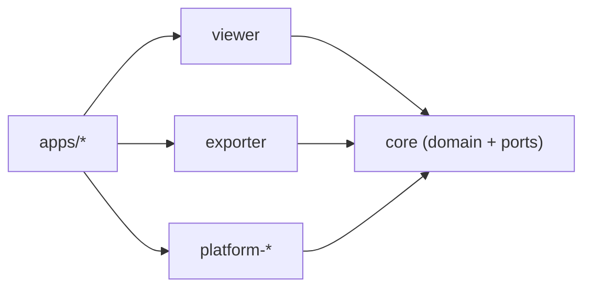

# WhatsAppya — Architecture

## Monorepo layout

```
WhatsAppya/
├── apps/                         # Deliverables (thin: composition + UI only)
│   ├── web/                      # Desktop web + Android PWA (Vite, TS)
│   ├── android-twa/              # Play Store wrapper around apps/web (Bubblewrap config only)
│   ├── cli/                      # Power-user CLI (replaces main.py)
│   └── ios/                      # Native Swift / SwiftUI app + Share Extension
│       ├── project.yml           #   XcodeGen spec (.xcodeproj is generated)
│       ├── WhatsAppya/           #   App target — feature folders
│       ├── ShareExtension/       #   Receives zip → App Group inbox (no parsing)
│       └── Packages/WhatsAppyaKit/  # SPM: WhatsAppyaCore (pure) + WhatsAppyaUI
├── packages/                     # Shared TypeScript libraries
│   ├── core/                     # Domain, ports, parsers, pipeline, use cases — zero deps
│   ├── platform-web/             # Browser adapters (zip, share target, OPFS)
│   ├── platform-node/            # Node adapters (fs)
│   ├── viewer/                   # Web Components viewer (virtualized)
│   ├── exporter/                 # Single-file offline HTML builder
│   └── design-tokens/            # Colours/motion → CSS vars + Swift
├── contracts/                    # JSON Schema: the TS ⇄ Swift data contract
├── fixtures/                     # Synthetic exports + golden outputs (shared by both languages)
├── docs/adr/                     # Architecture Decision Records
├── tools/scripts/                # Repo automation
└── .github/workflows/            # CI: TS, Swift, legacy Python
```

## Dependency rule (Clean / Hexagonal Architecture)



Arrows point inward only. `core` imports nothing — not the DOM, not Node, not a zip library.

## Patterns → where they live

| Pattern / principle | Location |
|---|---|
| Ports & Adapters (DIP) | `core/src/ports` ← `platform-web`, `platform-node`, Swift `Ports/` |
| Strategy | `ChatParser` — `IosParser`, `AndroidParser` |
| Registry / Factory (OCP) | `ParserRegistry` |
| Pipeline / Chain of Responsibility (SRP) | `core/src/pipeline` |
| Use Case / Application Service | `ConvertChat` |
| Result type (errors as values) | `core/src/shared/result.ts` |
| Builder | `exporter/StandaloneHtmlExporter` |
| Composition Root / manual DI | `apps/web/src/app/container.ts`, iOS `RootView` |
| Feature-sliced UI | `apps/*/features/*` |
| Contract + golden tests | `contracts/`, `fixtures/` |

## Migration from the Python prototype

The Python code (`converter/`, `main.py`, `tests/`, root `script.js`/`style.css`/`template.html`,
and the `assets/` mirror) stays in place and keeps running in CI until the TS core reaches golden-file
parity. It then moves to `legacy/python/` and is retired.
